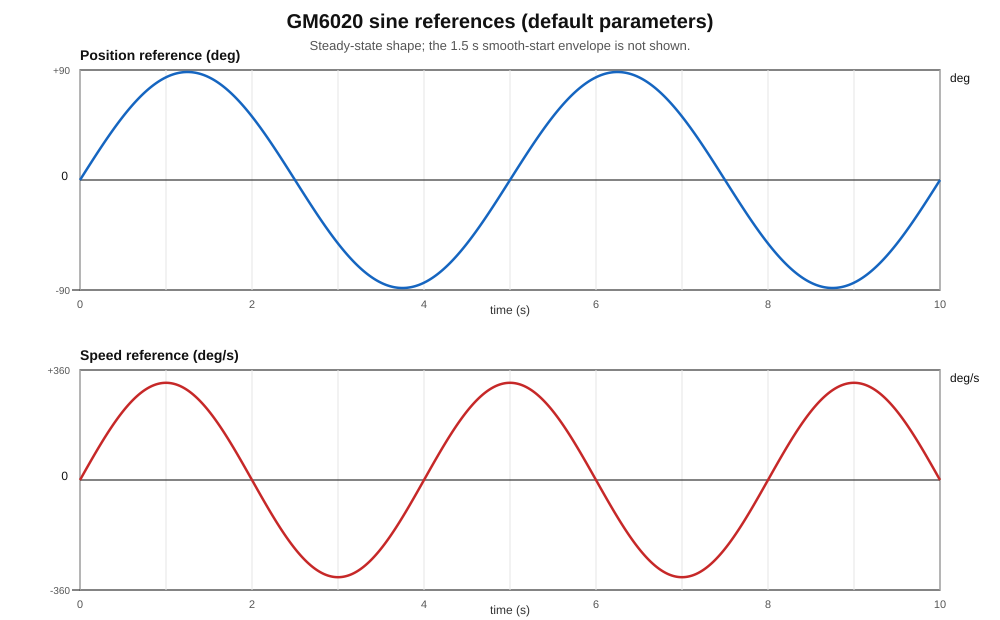

# GM6020 正弦位置/速度跟踪 + IWDG 看门狗

RoboMaster C 板（STM32F407IGH6）GM6020 控制例程，使用 **C 语言**、STM32CubeMX、CMake、VSCode 和 SEGGER Ozone。

实现内容：

- 固定采用**串级控制**：位置环（外环）输出速度给定，速度环（内环）再输出电压，两个环同时工作
- 位置模式为串级控制；速度模式单独跑速度正弦，用于整定速度环；用 `g_cmd_mode` 切换
- 位置正弦默认 ±90°、0.2 Hz
- 1 kHz 控制任务（TIM6），CAN1 1 Mbps 与 GM6020 通信
- 串级 PID + 速度前馈、微分测量、微分低通、输出限幅、电压变化率限幅
- IWDG 看门狗默认在 CubeMX 中使能；控制任务健康才喂狗，通信/控制异常会复位
- Ozone 工程、VSCode 任务、J-Link 下载脚本

> 第一次上电务必让电机空载、固定可靠，先确认 CAN 反馈和转向，再逐步加大 PID/幅值。

---

## 1. 硬件连接

### 1.1 电机与 C 板

| GM6020 | C 板 |
|---|---|
| 电源 + | 24 V（注意极性和功率） |
| 电源 - | 24 V 地 |
| CAN_H | CAN1_H |
| CAN_L | CAN1_L |
| GND（信号地） | GND |

- C 板 CAN1 引脚：`PD0 = CAN1_RX`，`PD1 = CAN1_TX`。
- CAN 总线两端各 120 Ω 终端电阻；C 板和电机之间尽量短，CAN_H/CAN_L 使用双绞线。
- GM6020 拨码 ID 设为 **1**（对应反馈 `0x205`，控制帧 `0x1FF`）。
- 本工程只用 CAN1、只用一颗 GM6020。`0x1FF` 帧中 ID 2~4 的数据保持 0，若总线上还有其它电机，需要扩展成多电机发送逻辑。

### 1.2 调试连接

- J-Link：`SWDIO = PA13`、`SWCLK = PA14`、`GND`、`3.3V`（参考 C 板 SWD 接口定义）。
- Ozone 选择 `STM32F407IG`，接口 `SWD`，速度 4 MHz。
- 串口不是必须的；本工程通过 Ozone 观察变量。

---

## 2. CubeMX 配置

工程文件：[`GM6020_SineTracker.ioc`](GM6020_SineTracker.ioc)

关键配置：

| 项目 | 配置 |
|---|---|
| MCU | STM32F407IGHx / STM32F407IGH6TR |
| 时钟 | HSE 12 MHz，PLL 168 MHz，APB1 42 MHz |
| CAN1 | 1 Mbps，Prescaler 3，BS1 6TQ，BS2 7TQ，Normal 模式 |
| CAN1 RX | `CAN1_RX0_IRQn`，抢占优先级 1 |
| TIM6 | Prescaler 84-1，Period 1000-1，1 kHz 更新中断，抢占优先级 2 |
| IWDG | Prescaler 64，Reload 400，默认激活 |
| SWD | PA13/PA14 |
| Toolchain | CMake |

IWDG 超时：

```
LSI ≈ 32 kHz
t = (Reload + 1) × Prescaler / LSI
  = (400 + 1) × 64 / 32000
  ≈ 0.802 s
```

CubeMX 生成的 `MX_IWDG_Init()` 一旦执行就无法关闭 IWDG。因此：

- 初始化完成后必须尽快开始喂狗；
- 本工程只在 1 kHz 控制任务中按健康状态喂狗；
- 调试时通过 `DBGMCU_APB1_FZ` 的 `DBG_IWDG_STOP` 位，让内核暂停时冻结 IWDG（`APP_IWDG_FREEZE_ON_DEBUG=1`）。

> 参考：STM32CubeMX 配置独立看门狗 IWDG 的说明  
> https://blog.csdn.net/m0_49126759/article/details/133755751

---

## 3. 编译

### 3.1 环境

- `arm-none-eabi-gcc`（Arm GNU Toolchain）
- CMake ≥ 3.22
- Ninja
- VSCode + `ms-vscode.cmake-tools` + `ms-vscode.cpptools`
- SEGGER Ozone / J-Link

把工具链加入 `PATH`，例如：

```powershell
$env:PATH = "D:\armGNUeabi\bin;D:\cmake\bin;D:\ninja;" + $env:PATH
```

### 3.2 命令行

在工程目录执行：

```powershell
cmake --preset Debug
cmake --build --preset Debug
```

产物：

```
build/Debug/GM6020_SineTracker.elf
build/Debug/GM6020_SineTracker.hex
build/Debug/GM6020_SineTracker.bin
```

VSCode 中按 `Ctrl+Shift+B` 执行默认任务 `CMake: build Debug`。

> 如果工程路径包含中文，建议使用较新的 CMake；本工程的 HEX/BIN 后处理已改为相对文件名 + `WORKING_DIRECTORY`，避免 `cmd.exe` 代码页把中文绝对路径传坏。若 J-Link/Ozone 仍有个别路径问题，可把工程放到纯英文路径。

### 3.3 下载

VSCode 任务 `J-Link: flash ELF` 会调用：

```text
JLink.exe -CommanderScript flash.jlink
```

也可以直接用 Ozone 的 `Download & Run`。

---

## 4. Ozone 调试

1. 先编译出 `build/Debug/GM6020_SineTracker.elf`。
2. 打开 Ozone，`File -> Open Project`，选择 [`ozone/GM6020_SineTracker.jdebug`](ozone/GM6020_SineTracker.jdebug)。
3. 选择 J-Link，接口 SWD，速度 4000 kHz。
4. `Debug -> Start`，然后 `Download & Run`。

### 4.1 建议加入 Global Data / Watch 的变量

| 变量 | 含义 |
|---|---|
| `g_cmd_mode` | 期望模式：0 停止，1 位置（串级），2 速度 |
| `g_dbg_mode` | 实际模式：0 停止，1 位置，2 速度（故障时强制 0） |
| `g_dbg_ref` | 当前给定（位置 rad / 速度 rad/s） |
| `g_dbg_meas` | 当前反馈（位置 rad / 速度 rad/s） |
| `g_dbg_error` | 给定 - 反馈 |
| `g_dbg_speed_ref` | 速度环给定 rad/s |
| `g_dbg_speed_error` | 速度给定 - 反馈，rad/s |
| `g_dbg_voltage` | 实际输出电压给定 |
| `g_dbg_angle` | 多圈累计角度 rad |
| `g_dbg_speed` | 转速反馈 rad/s |
| `g_dbg_temp` | 电机温度 °C |
| `g_fault_flags` | 故障位 |
| `g_wdg_feed_count` | 喂狗次数 |
| `g_boot_reset_cause` | 上次复位原因 |
| `g_control_tick` | 1 kHz 控制节拍 |
| `g_main_loop_counter` | 主循环心跳 |

位置模式下可以同时画两组曲线：

- 位置：`g_dbg_ref` 与 `g_dbg_meas`（单位 rad）；
- 速度：`g_dbg_speed_ref` 与 `g_dbg_speed`（单位 rad/s），误差看 `g_dbg_speed_error`。

### 4.2 切换模式

在 Ozone 里写 `g_cmd_mode` 即可切换，1 kHz 任务会在下一个周期处理：

```c
g_cmd_mode = 0;   // 停止
g_cmd_mode = 1;   // 位置模式(串级)，默认
g_cmd_mode = 2;   // 速度模式：只跑速度环，跟踪固定速度正弦
```

速度模式用于**单独整定速度 PID**：给定是 [app_config.h](Tasks/Inc/app_config.h#L40-L43) 里的 `APP_SPEED_AMPLITUDE_RAD_S` / `APP_SPEED_FREQ_HZ`（默认 ±1 rev/s、0.25 Hz）。

切换时程序会：

- 复位两个 PID 的积分和微分历史；
- 位置模式以当前角度为中心重新开始；
- 速度模式从 0 给定、1.5 s 平滑建立振幅。

故障（反馈超时、过温、过流、主循环卡死）会强制 `g_dbg_mode = 0`；故障消失后按 `g_cmd_mode` 重新进入。

---

## 5. 曲线定义

全部参数在 [`Tasks/Inc/app_config.h`](Tasks/Inc/app_config.h)。



> 图中是稳态形状；实际启动时还有 1.5 s 的 smoothstep 包络，幅值从 0 平滑建立。

### 5.1 位置曲线

```
θ_ref(t) = θ0 + A_p · env(t) · sin(2π f_p t)
```

默认：

```c
#define APP_POS_AMPLITUDE_RAD   (0.5f * APP_PI)   // ±90°
#define APP_POS_FREQ_HZ         0.20f             // 5 s 周期
#define APP_SINE_RAMP_TIME_S    1.5f
```

`θ0` 是开始跟踪时的角度，`env(t)` 是 smoothstep 启动包络（1.5 s 内 0→1），避免上电瞬间给定和速度前馈突变。

峰值速度：

```
A_p · 2π f_p = 1.5708 × 1.2566 ≈ 1.97 rad/s ≈ 18.8 rpm
```

### 5.2 速度给定

**位置模式（`g_cmd_mode = 1`）**：速度给定由两部分相加（[app_control.c](Tasks/Src/app_control.c#L372-L390)）：

```
ω_ref = 位置环 PID 输出 + APP_POS_VEL_FF · dθ_ref/dt
```

- 位置环负责消除位置误差；
- `dθ_ref/dt` 是位置曲线的微分，作为速度前馈，`APP_POS_VEL_FF = 1.0` 时是完整前馈；
- 结果限制在 ±`APP_POS_SPEED_LIMIT_RAD_S`（默认 6 rad/s）。

**速度模式（`g_cmd_mode = 2`）**：速度给定是一条固定的正弦曲线，用来单独整定速度 PID：

```c
#define APP_SPEED_AMPLITUDE_RAD_S  (2.0f * APP_PI)  // ±1 rev/s
#define APP_SPEED_FREQ_HZ          0.25f            // 4 s 周期
```

两种模式共用同一个速度环（`APP_SPEED_KP/KI/KD`）和反电动势前馈 `APP_SPEED_FF`。

### 5.3 自定义示例

改成 ±30°、0.5 Hz 位置正弦：

```c
#define APP_POS_AMPLITUDE_RAD   (APP_PI / 6.0f)
#define APP_POS_FREQ_HZ         0.50f
```

修改后重新编译。若电机出现抖动/过流，先降低幅值、频率、`APP_POS_KP` 或 `APP_SPEED_KP`。

---

## 6. 控制结构

```
TIM6 1 kHz 中断
    └─ AppControl_1kHz()
         ├─ 读取 GM6020 状态快照
         ├─ 反馈超时 / 温度 / 电流 / 主循环心跳检查
         ├─ 故障 -> 输出 0 并复位两个 PID
         ├─ 按 g_cmd_mode 选择: 0 停止 / 1 位置(串级) / 2 速度
         ├─ 位置模式: 位置环 PID -> 速度给定 + 曲线微分前馈
         │  或 速度模式: 固定速度正弦 -> 速度给定
         ├─ 速度给定限幅 ±APP_POS_SPEED_LIMIT_RAD_S
         ├─ 速度环 PID(速度误差) + 反电动势前馈 -> 电压给定
         ├─ 输出限幅 + 电压变化率限幅
         ├─ CAN 发送 0x1FF
         └─ 健康时 HAL_IWDG_Refresh()

CAN1 RX0 中断（优先级 1）
    └─ HAL_CAN_RxFifo0MsgPendingCallback()
         └─ GM6020_OnCanRx() 解析 0x205
```

### 6.1 GM6020 驱动

[`Tasks/Src/gm6020.c`](Tasks/Src/gm6020.c)

- 控制帧：`0x1FF`（ID 1~4）/ `0x2FF`（ID 5~7），大端 int16，范围 ±25000。
- 反馈帧：`0x204 + ID`。
- 反馈解析：角度 0~8191、转速 rpm、转矩电流、温度。
- 跨零检测累计多圈角度；第一次收到反馈时把当前位置设为 0 点。
- 状态读取用 `PRIMASK` 临界区，避免和 CAN 中断竞争。

### 6.2 PID

[`Tasks/Src/pid.c`](Tasks/Src/pid.c)

```
u = Kp·e + I + Kd·d(-y)/dt
```

- 微分作用在测量值上，避免给定阶跃导致微分冲击；
- 微分项一阶低通；
- 输出限幅 + 条件积分抗饱和；
- 故障停止/恢复时 `PID_Reset()` 清空积分和微分历史。

默认增益（串级：位置环 → 速度环）：

```c
/* 外环: 位置环, 输入 rad, 输出速度给定 rad/s */
#define APP_POS_KP                  12.0f
#define APP_POS_KI                  0.0f
#define APP_POS_KD                  0.0f
#define APP_POS_VEL_FF              1.0f
#define APP_POS_SPEED_LIMIT_RAD_S   6.0f

/* 内环: 速度环, 输入 rad/s, 输出电压给定 */
#define APP_SPEED_KP                1800.0f
#define APP_SPEED_KI                1000.0f
#define APP_SPEED_KD                0.0f
```

这些是空载起步值，必须按实车调整。**先内环、后外环**：

1. 先把 `APP_POS_AMPLITUDE_RAD` 改小（如 ±10°）或把 `APP_POS_KP` 设为 0，让电机基本不动，只看内环；
2. 观察 `g_dbg_speed_ref` 与 `g_dbg_speed`，从小 `APP_SPEED_KP` 加到能跟随但不过冲；
3. 加 `APP_SPEED_KI` 消除静差，观察低速是否爬行/振荡；
4. 恢复幅值，从小 `APP_POS_KP` 往上调，直到位置跟随误差可接受且没有来回过冲；
5. 内环振荡先降 `APP_SPEED_KP`；外环过冲先降 `APP_POS_KP` 或降低 `APP_POS_SPEED_LIMIT_RAD_S`；
6. `APP_POS_VEL_FF` 从 1.0 开始，相位滞后明显可保留或加大，过冲则减到 0.5~0.8；
7. 外环一般不需要 `APP_POS_KD`，阻尼由内环提供；
8. 每次只改一个参数，记录波形。

### 6.3 输出保护

```c
#define APP_OUTPUT_LIMIT       12000.0f   // 约 11.5 V，不是满 24 V
#define APP_OUTPUT_SLEW_PER_S  250000.0f  // 10 ms 走完全量程
```

调试时不要直接把 `APP_OUTPUT_LIMIT` 改成 25000。

---

## 7. 看门狗保护

### 7.1 喂狗条件

[`Tasks/Src/app_control.c`](Tasks/Src/app_control.c) 的 `app_watchdog_service()`：

- 正常：每 1 ms 喂一次；
- 反馈丢失超过 `APP_FEEDBACK_TIMEOUT_MS`（20 ms）：输出 0，进入故障；
- 主循环超过 `APP_MAIN_LOOP_TIMEOUT_MS`（100 ms）没有心跳：严重故障；
- 严重故障后仍给 `APP_WDG_GRACE_MS`（300 ms）恢复窗口，之后停止喂狗；
- IWDG 约 0.8 s 后复位 MCU，总时间约 1.1 s；
- 过温/过流：输出 0，但继续喂狗，方便在 Ozone 查看故障；过流锁存，需复位。

### 7.2 验证看门狗

在 Ozone 中把：

```c
g_wdg_test_inhibit = 1;
```

然后 `Resume`。程序会立即停止喂狗，约 0.8 s 后复位。复位后观察：

- `g_wdg_feed_count` 停止增长；
- `g_boot_reset_cause & 0x01` 为 1（`APP_RESET_IWDG`）；
- 电机输出为 0。

把 `g_wdg_test_inhibit` 写回 0 即可恢复正常。该变量复位后自动为 0。

### 7.3 调试时冻结 IWDG

`APP_IWDG_FREEZE_ON_DEBUG = 1` 时，Ozone 暂停内核会冻结 IWDG，避免一暂停就复位；运行态看门狗仍然有效。若要做“暂停内核也复位”的演示，把它改成 0 并重新编译。

---

## 8. 运行逻辑

用 `g_cmd_mode` 选择模式（默认 1 位置）：

- `1` 位置模式：上电、收到反馈后自动跟踪位置正弦，速度环作为内环；
- `2` 速度模式：只跑速度环，速度给定是固定正弦，适合单独整定速度 PID；
- `0` 停止：输出 0，两个 PID 复位；
- 切换时复位 PID、按新模式重建曲线；位置模式以当前角度为起点，不会跳回零；
- 故障（反馈超时、过温、过流、主循环卡死）时强制停止，`g_dbg_mode = 0`，故障消失后按 `g_cmd_mode` 恢复。

---

## 9. 文件说明

| 路径 | 说明 |
|---|---|
| `Tasks/Inc/app_config.h` | 所有可调参数：曲线、PID、限幅、看门狗 |
| `Tasks/Src/app_control.c` | 1 kHz 控制、串级 PID、故障与喂狗 |
| `Tasks/Src/gm6020.c` | GM6020 CAN 驱动 |
| `Tasks/Src/pid.c` | PID |
| `Tasks/Src/sine_profile.c` | 正弦给定 + 启动包络 |
| `Core/Src/main.c` | CubeMX 主程序，调用 `AppControl_Init()` |
| `Core/Src/iwdg.c` | CubeMX 生成的 IWDG 初始化 |
| `Core/Src/can.c` | CubeMX 生成的 CAN1 初始化 |
| `Core/Src/tim.c` | CubeMX 生成的 TIM6 1 kHz 初始化 |
| `ozone/GM6020_SineTracker.jdebug` | Ozone 工程 |
| `flash.jlink` | J-Link Commander 下载脚本 |
| `CMakeLists.txt` | 用户源文件、HEX/BIN 后处理 |
| `GM6020_SineTracker.ioc` | CubeMX 工程 |

> 根目录的 `C_board_src` 是原有的 C++ 参考代码，不参与本工程编译。本工程全部为 C。

---

## 10. 验收步骤

1. 空载固定电机，24 V 限流电源上电，J-Link 连接，Ozone 打开工程并 `Download & Run`。
2. 观察 `g_fault_flags` 应为 0，`g_wdg_feed_count` 约每秒增加 1000，`g_dbg_mode` 应为 1。
3. 位置模式：`g_dbg_ref` 与 `g_dbg_meas` 应为 ±1.57 rad 的正弦；同时速度环 `g_dbg_speed_ref` 与 `g_dbg_speed` 应为 ±1.97 rad/s 的正弦，两者相差 90°。
4. 写 `g_cmd_mode = 2`，速度环应跟踪 ±6.28 rad/s、0.25 Hz 的速度正弦；`g_dbg_ref`/`g_dbg_meas` 变成速度给定/反馈，用它整定速度 PID。
5. 写 `g_cmd_mode = 0` 确认输出为 0，再写回 1 确认恢复位置跟踪。
6. 在 Ozone 中把 `g_wdg_test_inhibit=1`，确认约 0.8 s 后复位；复位后 `g_boot_reset_cause & 0x01` 为 1。
7. 拔掉 CAN 线或断开电机电源，确认输出立即为 0（`g_dbg_mode` 变 0），约 1.1 s 后看门狗复位（重新上电/恢复 CAN 后正常）。
8. 记录位置/速度跟随波形和 PID 参数，按实际负载微调。

> 没有硬件时只能完成编译检查；位置/速度环的实际波形必须在 C 板和 GM6020 上验证。

---

## 11. 常见问题

**Q1：Ozone 一暂停就复位？**  
确认 `APP_IWDG_FREEZE_ON_DEBUG=1`，并且是 Debug 构建。Ozone 连接后不要先长时间停在复位向量。

**Q2：上电后电机不转，但 Ozone 有 1 kHz 节拍？**  
看 `g_fault_flags`：

- bit0 反馈超时：检查 GM6020 ID、CAN_H/L、120 Ω、24 V、GND；
- bit1 过温：电机温度 > 75 °C；
- bit2 过流：电流原始值连续 100 ms ≥ 15000；
- bit3 主循环：检查是否在 `while(1)` 里加了长时间阻塞代码。

**Q3：电机方向反了？**  
两种方法：

1. 把 `APP_POS_AMPLITUDE_RAD` 取反（整条曲线反相）；
2. 在 `AppControl_1kHz()` 输出前给 `voltage` 加负号（位置和速度环一起反转）。

**Q4：位置中心点不对？**  
程序以“开始跟踪时的角度”为中心。上电后第一次反馈会把当前角度设为 0；如果希望固定机械零位，需要在 `GM6020_OnCanRx()` 第一次收到反馈时记录绝对角度，或外接零位开关。

**Q5：CubeMX 重新生成后用户代码会丢吗？**  
`main.c` 的 `USER CODE` 区域和 `Tasks/` 目录不会被 CubeMX 删除；`CMakeLists.txt` 的 `Tasks` 源文件列表需要保留。重新生成后检查 `Core/Src/main.c` 里 `AppControl_Init()` 和 `AppControl_MainLoop()` 是否还在。

**Q6：可以控制多颗 GM6020 吗？**  
当前驱动按单电机写。多电机需要：

- 每颗电机一个 `GM6020` 实例；
- 同一 `0x1FF/0x2FF` 帧内按 ID 填 2 字节；
- 每颗电机单独 PID/曲线；
- 注意总线上其它电机不能被填 0 误停。

---

## 12. 安全注意

- 24 V 电源必须有过流/急停；调试时建议串限流电源。
- 电机必须可靠固定，转子附近不要有手、线缆、衣物。
- 先空载、低幅值、低频率；确认反馈符号和 PID 方向正确后再加载。
- CAN 线不要热插拔；断电后再改线。
- `APP_OUTPUT_LIMIT=12000` 是调试值，不要随意改成 25000。
- 看门狗复位会立即失去控制输出；如果机构有重力负载，需机械制动/限位。
